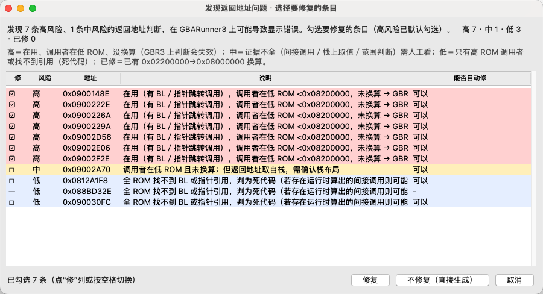
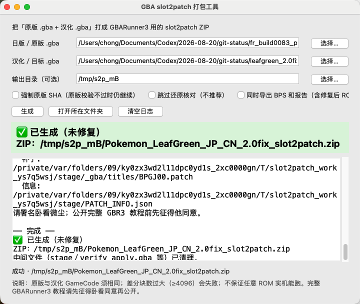
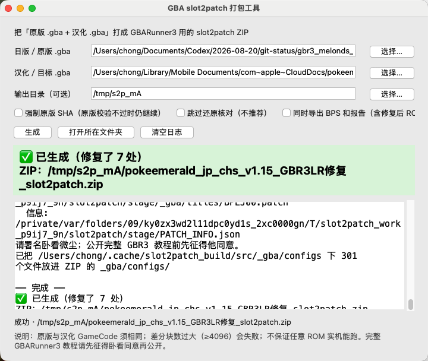

# slot2patch 补丁打包工具 v2

基于卧看（Wokann）PatchTool 的 slot2patch 补丁打包工具 v2。差分格式与 PatchTool 作者为 **卧看微尘（Wokann）**，原仓库：[Wokann/PatchToolForGbaR3](https://github.com/Wokann/PatchToolForGbaR3)。打出的补丁供 [Wokann/GBARunner3](https://github.com/Wokann/GBARunner3) 的 slot2patch 使用。本目录在上述工具上做封装、LR 返回地址扫描与打包。

**本文件夹供卧看审核。** 放在本材料仓库中，供作者查看，不代表上游已经采纳。

## 功能

在界面点 **「生成」** 时，会先自动深度扫描 LR（返回地址）地址问题，并按 **高 / 中 / 低** 风险分级：

- 没有高风险或中风险：直接生成 slot2patch ZIP。
- 有高风险或中风险：弹出列表窗口，列出风险、地址和说明。可选择 **修复**、**不修复（直接生成）** 或 **取消**。
- 选择修复后，再生成 slot2patch ZIP。
- 可选同时导出 BPS 和报告（含修复后 ROM，仅本地自测；请分发 BPS / ZIP）。
- 生成的 ZIP 默认不再带 `_gba/configs`。只有显式给出 `--configs` 时才会加进去。

更细的操作、命令行和已知限制见 [src/使用说明.md](src/使用说明.md)，打包参数见 [src/README.md](src/README.md)。

## 界面截图

有高 / 中风险时弹出的选择窗口：



不修复、直接生成后的主界面：



修复后生成的主界面：



## 目录

| 路径 | 内容 |
|---|---|
| `src/` | 源码、界面脚本、卧看 PatchTool 源码与 Windows 差分工具 `PatchToolForGbaR3.exe`、`_gba/configs/` |
| `release/slot2patch工具_mac_arm64.zip` | Mac arm64 独立 `.app`（`slot2patch工具.app`），压缩包原样存放 |
| `release/slot2patch工具_windows_x64.zip` | Windows x64 免安装程序（`slot2patch工具.exe` 与 `_internal/`），由 GitHub Actions 在 `windows-latest` 上用 PyInstaller 打出 |
| `merge3_*.png` | 上面三张界面截图 |
| `SHA256SUMS.txt` | 上面两个压缩包的 SHA256 |

Mac 与 Windows 压缩包 SHA256（已核对，与 `SHA256SUMS.txt` 一致）：

```
5b9aea3782bdda524a3b0073032a1357d99a294e00c87172d2466550a67cdea0  slot2patch工具_mac_arm64.zip
6c9df58421d80694fcf09506b0a7c0ffe97bcc39a199bbb28efca02377d13e07  slot2patch工具_windows_x64.zip
```

Windows 压缩包大小：12,712,689 字节。

## 使用与限制

- **Mac 版**内置 Python 3.12 和 Tk 9，不需要另行安装 Python。解压 ZIP 后打开 `slot2patch工具.app`。
- **Windows 版**（x64）内置 Python 3.12.10 和 Tk 8.6，不需要另行安装 Python。解压 `release/slot2patch工具_windows_x64.zip` 后双击 `slot2patch工具.exe`。exe 必须和旁边的 `_internal` 文件夹放在一起。
- **Windows 包未经代码签名。** 首次打开可能触发 SmartScreen（“Windows 已保护你的电脑”）。请点“更多信息”→“仍要运行”。
- **未经 Apple 公证。** Mac 版首次打开若被系统拦截，请在 Finder 中对 `slot2patch工具.app` 右键 → 打开。
- **未经充分实机验证。** Windows 包只在 GitHub 的 `windows-latest` 上做过启动冒烟：`--run-core --help` 与 `--run-lr --help` 退出码为 0；两者不带参数时退出码为 2，并提示缺少必填参数；直接启动能创建标题为「GBA slot2patch 打包工具」的窗口；包内能找到 `PatchToolForGbaR3.exe` 和 301 个配置。没有用 ROM 生成补丁，也没有在 GBARunner3 实机上验证扫描或修复。
- **不提供 ROM、BIOS、NDS**，也不含完整 GBR3 教程。游戏 ROM 请自备。公开完整实机教程前请先征得卧看同意。
